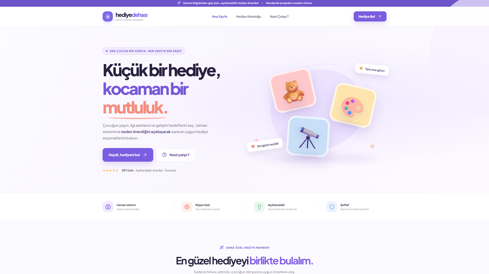
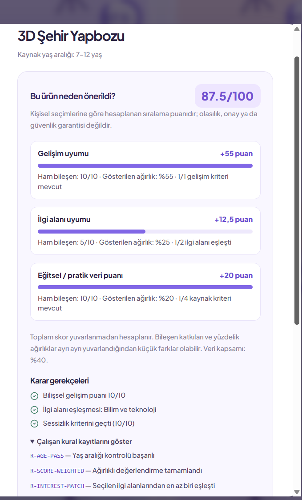

# Hediye Dehası — Explainable, Rule-Based Gift Recommendation System

[](https://github.com/fathylmaz/hediye-dehasi/actions/workflows/ci.yml)

**Quick links:** [Academic report (PDF)](docs/Hediye_Dehasi_Uzman_Sistem_Gelistirme_Raporu.pdf) · [Project slides (PDF)](docs/Hediye_Dehasi_Proje_Sunumu_Fatih_Gamze.pdf) · [Setup](INSTALL_WINDOWS.md) · [Türkçe](README.md)


**Project authors:** Fatih Yılmaz · Gamze Özateş

**Academic report (Turkish):** [Expert System Development Report (PDF)](docs/Hediye_Dehasi_Uzman_Sistem_Gelistirme_Raporu.pdf) · [Project presentation (PDF)](docs/Hediye_Dehasi_Proje_Sunumu_Fatih_Gamze.pdf)

**Hediye Dehası** is a rebuilt version (2026) of a university expert-system project focused on choosing age-appropriate gifts for children. It uses deterministic expert rules and transparent multi-criteria scores, **not** a trained ML model or a product-safety certification service.

## What it does

- Three-step recommendation wizard: age, development goals, interests and preferences.
- Hard eligibility constraints: age, optional quietness, technology intensity and a **source-data safety rating** threshold.
- Weighted 0–100 compatibility scoring with per-product component breakdown, explanatory reasons and fired-rule traces.
- Source-data field coverage shown **separately** from compatibility; missing inputs are not fabricated.
- Two ranking policies: evidence-coverage-first (default), or score-only.
- 397 normalized catalog records; search, category filters and detailed product profiles.
- Responsive Turkish UI, Python REST API, SQLite storage, Docker Compose and automated backend tests.

## Screenshots

The screenshots show a locally running application; product illustrations are representative rather than verified photographs.





## Stack

| Layer | Technology |
|---|---|
| Web | React, TypeScript, Vite |
| API | Python, FastAPI, Pydantic |
| Rules | Deterministic forward rule checks and weighted scoring |
| Persistence | SQLite; JSON catalog with provenance |
| Deployment | Docker Compose, Nginx |
| Quality | pytest, GitHub Actions |

## Local setup

From the repository root with Docker Desktop running:

```bash
docker compose up --build -d
docker compose ps
```

- Web UI: http://localhost:8080
- API documentation: http://localhost:8000/docs
- Stop: `docker compose down`

For Windows-only setup and development without Docker, see [INSTALL_WINDOWS.md](INSTALL_WINDOWS.md). The detailed Turkish project overview and source-data limitations are in [README.md](README.md).

## Validation status

- **29/29 backend tests passed** again in the preparation environment.
- User reported that v3 runs locally and confirmed **4/4** key manual workflows (recommendation generation, ranking modes, evidence coverage and rule explanations).
- The repository owner reported a green GitHub Actions run after the first push (backend tests and frontend build workflow). A separate local v3 build transcript and detailed CI logs are not included in this document; end-to-end browser tests and external expert validation remain future work.

## Academic origin and attribution

The initial gift-selection expert system was a **university team project**, which included additional team roles beyond the two names listed for this repository. The current published software and documentation name **Fatih Yılmaz** and **Gamze Özateş** as authors. Original participants' identifiers and contribution details should only be published when verified and appropriately authorized.

## License and reuse

No open-source `LICENSE` has been selected for this repository yet. Public visibility alone does not grant permission to redistribute or commercially reuse its code or academic datasets. Source-data redistribution rights and shared academic contributions require separate verification.

## Data and limitations

Catalog values originate from an older academic dataset. There are **no verified live prices, stock levels, official age/safety certificates, or authentic product photographs**. Compatibility scores are rankings, **not probabilities**. Field coverage measures availability of input fields, not reliability, safety or accuracy. The software is an academic decision-support prototype, not a shopping or medical/safety authority.

Source-data redistribution rights should be checked before making the repository public. Original interview and presentation files containing participant identifiers are excluded. The university project and the 2026 re-engineering work should be credited separately.

See [GitHub publishing guide](docs/GITHUB_PUBLISHING.md) and [release notes](docs/PUBLICATION_NOTES.md).
